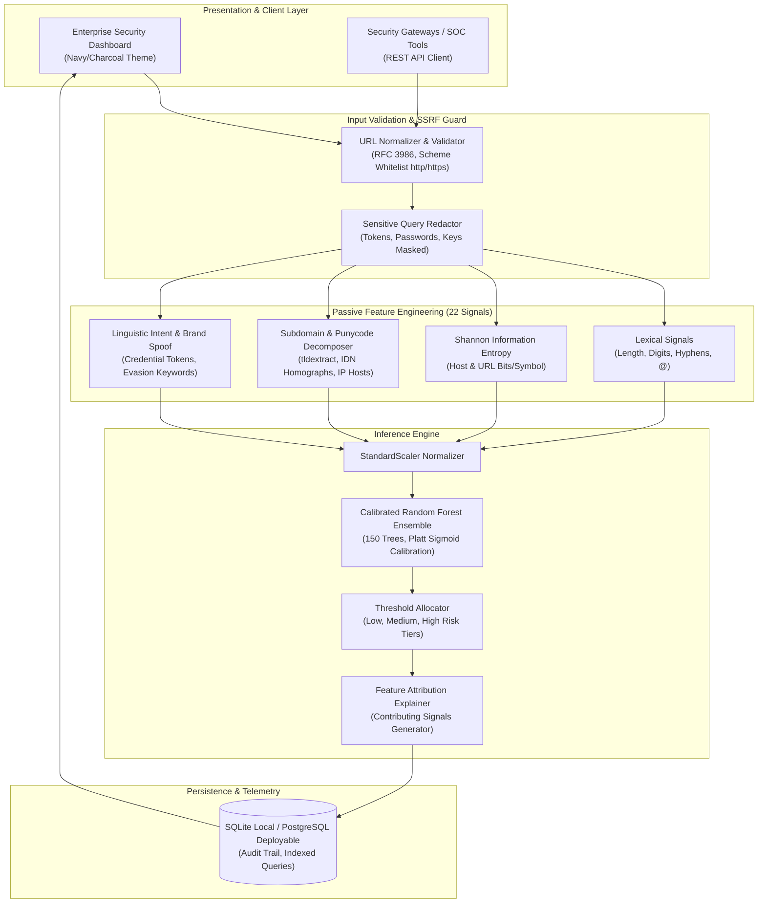

# URLShield | Phishing Intelligence

[](https://github.com/jeevan0345/urlshield/actions)


> **Enterprise-grade Phishing URL Detection & Threat Intelligence Platform** built with Python, scikit-learn, and Flask. Operates with zero network egress (complete SSRF immunity), extracting 22 lexical, structural, and Shannon entropy signals to deliver calibrated risk probabilities and explainable factor attributions.

---

## 🏛️ System Architecture



---

## 🚀 Key Highlights & Engineering Quality

- **Zero-SSRF Security Guarantee:** URLShield analyzes strings completely offline without establishing TCP connections or downloading remote content, preventing Server-Side Request Forgery, internal port scanning, and drive-by malware delivery.
- **Group-Aware Leakage Prevention:** Evaluated using 5-Fold `GroupKFold` split strictly by registered domain, guaranteeing zero domain overlap between training and test sets.
- **Rigorous Evaluation on Real Data:**
  - **Accuracy:** `95.51%` on 602 completely unseen domain samples.
  - **Precision:** `95.93%` (low false alarms on safe corporate sites).
  - **Recall:** `94.97%` (283 out of 298 phishing URLs intercepted).
  - **F1 Score:** `95.45%` | **ROC-AUC:** `0.9900` | **PR-AUC:** `0.9912`.
- **Calibrated Probabilistic Scoring:** Employs Platt sigmoid calibration to output true empirical probabilities rather than uncalibrated heuristic scores.
- **Dual Storage Engine:** SQLite by default for zero-configuration local development; native PostgreSQL support for cloud deployments via `DATABASE_URL`.
- **Sensitive Parameter Redaction:** Automatically masks credentials, auth tokens, and session keys in logs and database storage.

---

## 🛠️ Quickstart

### Method A: One-Click Run (Windows)
Double-click `run.bat` in the project folder, or run:
```cmd
run.bat
```
This automatically uses `.venv` and launches the application at **[http://localhost:5000](http://localhost:5000)**.

---

### Method B: Command Prompt (cmd.exe)

```cmd
# 1. Activate the virtual environment
.\.venv\Scripts\activate.bat

# 2. Run the test suite
pytest -v

# 3. Launch the dashboard
python run.py
```
> Alternatively without activating: `.\.venv\Scripts\python.exe run.py`

---

### Method C: Windows PowerShell

```powershell
# 1. Activate the virtual environment
.\.venv\Scripts\Activate.ps1

# 2. Run the test suite
pytest -v

# 3. Launch the dashboard
python run.py
```

Open your browser at **[http://localhost:5000](http://localhost:5000)** to explore the interactive security dashboard.

---

## 🧪 Reproducible ML Training & Evaluation

URLShield includes end-to-end reproducible scripts to acquire open public data, clean it, and retrain the model pipeline:

```powershell
# Step 1: Download Tranco Top Sites + PhishTank + URLhaus + OpenPhish and perform domain-grouped split
python scripts/prepare_dataset.py

# Step 2: Train Logistic Regression baseline and Random Forest champion, run 5-Fold Group CV, calibrate, and evaluate
python scripts/train_evaluate.py
```

This updates `models/phishing_model.joblib`, `models/model_metadata.json`, and `models/feature_schema.json`.

---

## 🔌 REST API Documentation

### 1. Analyze URL
- **Endpoint:** `POST /api/v1/scan`
- **Request Headers:** `Content-Type: application/json`
- **Request Body:**
  ```json
  {
    "url": "http://paypal-verification-account-update.info/login?cmd=_login-run"
  }
  ```
- **Response (201 Created):**
  ```json
  {
    "success": true,
    "data": {
      "id": "e81f72da-4b36-419b-a311-66779b5b9319",
      "input_url": "http://paypal-verification-account-update.info/login?cmd=_login-run",
      "redacted_url": "http://paypal-verification-account-update.info/login?cmd=_login-run",
      "domain": "paypal-verification-account-update.info",
      "is_phishing": true,
      "prediction": "phishing",
      "probability": 0.9886,
      "risk_tier": "high",
      "risk_label": "Dangerous / High Risk",
      "risk_color": "rose",
      "contributing_factors": [
        {
          "factor": "Suspicious Keywords (3)",
          "severity": "danger",
          "description": "URL contains credential or finance keywords: login, update."
        },
        {
          "factor": "Insecure Scheme (HTTP)",
          "severity": "warning",
          "description": "Connection is unencrypted (HTTP) rather than HTTPS."
        }
      ],
      "model_version": "1.0.0",
      "created_at": "2026-10-20T07:11:04Z"
    }
  }
  ```

### 2. List & Filter Historical Scans
- **Endpoint:** `GET /api/v1/scans?page=1&per_page=10&risk_tier=high&search=paypal`
- **Response (200 OK):** Paginated records matching filter.

### 3. Retrieve Scan by ID
- **Endpoint:** `GET /api/v1/scans/<id>`

### 4. Delete Scan
- **Endpoint:** `DELETE /api/v1/scans/<id>`

### 5. Export Audit Logs as CSV
- **Endpoint:** `GET /api/v1/scans/export/csv`

### 6. Model Evaluation Metrics & Metadata
- **Endpoint:** `GET /api/v1/model/metrics`

### 7. Health Check Probe
- **Endpoint:** `GET /health`
- **Response (200 OK):**
  ```json
  {
    "status": "healthy",
    "service": "URLShield | Phishing Intelligence",
    "version": "1.0.0",
    "components": {
      "database": "connected",
      "model_pipeline": "loaded"
    }
  }
  ```

---

## 🐳 Docker & Container Deployment

### Running with Docker

```bash
docker build -t urlshield .
docker run -p 5000:5000 urlshield
```

### Running with Docker Compose (PostgreSQL Persistent Database)

```bash
docker-compose up --build -d
```

---

## 📄 License
This project is licensed under the MIT License - see the [LICENSE](LICENSE) file for details.
